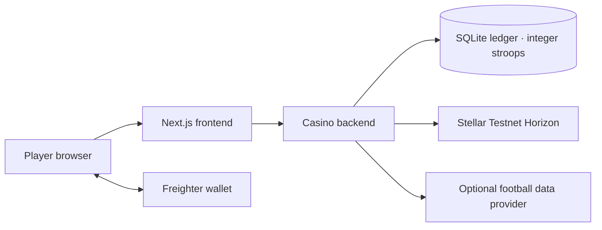

# RemitPulse casino and sportsbook backend

This Node.js 24 service owns game outcomes, sports tickets, and an exact XLM ledger in SQLite. Every XLM equals 10,000,000 stroops.

## Architecture



| Balance | Source | Used for |
| --- | --- | --- |
| Simulated XLM | Demo grant and simulated settlements | Casino and sports wagers |
| Credited Testnet XLM | Confirmed native XLM deposits | Withdrawals to the linked wallet |
| On-chain wallet XLM | Stellar Testnet account | Funds held by the player's wallet |
| Treasury XLM | Operator's Testnet account | Holds deposits and sends withdrawals |

The browser calls the same-origin Next.js relay at `/api/casino`. Keep the backend private in hosted deployments. The backend owns settlement and ledger mutations. A signed deposit is credited once, and a withdrawal reserves funds before submission.

## Start locally

```sh
npm ci
npm start
```

The default bind address is `127.0.0.1:4010`. Copy `.env.example` to `.env` for local overrides. Run `npm run typecheck` and `npm test` to verify the service.

### Configuration

| Variable | Default or purpose |
| --- | --- |
| `PORT`, `CASINO_HOST` | `4010`, `127.0.0.1` locally |
| `CASINO_PUBLIC_ORIGIN` | Exact frontend origin for passkeys |
| `CASINO_SECURE_COOKIE` | Set to `1` when served over HTTPS |
| `CASINO_DATA_DIR` | SQLite directory, defaults to `.casino-data` locally |
| `CASINO_TESTNET_TREASURY_SECRET` | Optional funded Testnet signer. Store it as a deployment secret. |
| `CASINO_ADMIN_TOKEN` | Optional bearer token for the operator report and recovery actions |
| `CASINO_FOOTBALL_DATA_TOKEN` | Optional server-side football-data.org token |

The supplied Compose file forwards the treasury and operator credentials. To enable provider football under Compose, also pass `CASINO_FOOTBALL_DATA_TOKEN` into the `casino` service environment.

### API at a glance

| Route | Purpose |
| --- | --- |
| `GET /health` | Backend liveness and network identity |
| `GET /game` | Load or establish the player session and return balances and activity |
| `POST /game` | Process game actions, sports tickets, wallet operations, and passkeys |
| `GET /admin` | Operator treasury, liability, and reconciliation report |
| `GET /admin/transfer/{hash}` | Read Horizon status and envelope expiry |
| `POST /admin/transfer/{hash}` | Reconcile an already recorded Testnet outcome |

Player POST requests use JSON and the cookie issued by a preceding GET. Operator requests require `Authorization: Bearer <token>`.

## Games and sportsbook

- Each new demo account receives 1,000 simulated XLM. Wagers, payouts and balances use integer stroops. Server-side random draws determine casino outcomes.
- Mines stores the full board on the server, locks the selected mine count, and returns the current and next-safe-tile payout estimates. The board is revealed when the round ends.
- Casino results include the data needed for the interface to show the outcome, such as drawn cards, Keno numbers, or the Plinko path.
- The default sportsbook offers fictional football, basketball and tennis fixtures with server-quoted decimal odds. The sportsbook enforces the kickoff cutoff, reserves the stake and settles each eligible ticket once against a shared match result. Simulated fixture tickets settle when the player refreshes the market or session.
- The shared ledger keeps simulated credits separate from withdrawable Testnet XLM.

## Dice verification

The Dice client requests a SHA-256 commitment before generating its client
seed. The settlement consumes that commitment once, calculates the roll
using HMAC-SHA256 with rejection sampling, and records the revealed seed,
roll, target, stake, and payout in an Activity receipt. The contracts
checkout provides an independent receipt verifier.

## Football data

Set `CASINO_FOOTBALL_DATA_TOKEN` in the backend environment to use
[football-data.org](https://docs.football-data.org/general/v4/match.html)
for football fixtures and regulation-time results. The sportsbook still uses
simulated odds and simulated XLM. When the configured feed is unavailable,
new provider football tickets are paused. Existing tickets wait for a valid
result. Cancelled or awarded fixtures are voided and refunded. A provider
score revision is displayed separately from the original settlement.

## Stellar Testnet and passkeys

Set `CASINO_TESTNET_TREASURY_SECRET` to a funded Testnet-only Stellar account to enable native XLM deposits and withdrawals. Freighter signs deposits. The backend credits a verified transaction hash once. Withdrawals reserve Testnet funds and send them to the linked wallet. Retries use the same signed envelope. The player and operator can check the same transaction hash after an interruption. A failed withdrawal receipt returns its reserve, and a failed deposit closes without credit. An expired envelope with no Horizon receipt remains pending for operator investigation.

Set `CASINO_ADMIN_TOKEN` to enable the operator report. Set `CASINO_PUBLIC_ORIGIN` to the exact frontend origin for passkeys. Use HTTPS and `CASINO_SECURE_COOKIE=1` outside local development.

### Transfer recovery

| Horizon outcome | Deposit | Withdrawal |
| --- | --- | --- |
| Confirmed | Credit once by transaction hash | Close the reservation without debiting again |
| Failed | Record failure without credit | Return the reserved stroops once |
| No receipt, envelope valid | Retry the same signed envelope | Retry the same signed envelope |
| No receipt, envelope expired | Keep pending for investigation | Keep the reserve pending for investigation |

Use the operator dashboard to check the hash, wallet, and amount. Export the transfer record for independent verification in the [treasury toolkit](https://github.com/Remitpulse/contracts/tree/stellar-casino-milestone). Compare treasury and player liabilities with attention to pending transfers and Stellar account reserves.

## Deploy both services

Place the frontend and backend checkouts side by side, with the frontend directory named `frontend`. From the backend checkout, run `docker compose up --build --wait`. The frontend binds to loopback on port 3000. The private backend stores the ledger on the `casino-ledger` volume.

On a remote host, forward HTTPS requests to `127.0.0.1:3000`. Set `CASINO_PUBLIC_ORIGIN` without a trailing slash and `CASINO_SECURE_COOKIE=1` in the backend checkout’s `.env`. Keep Testnet signing secrets outside Git. Back up the database using SQLite-aware tools. Real-money authorization and jurisdiction checks are outside this milestone.

See [Mainnet launch readiness](docs/mainnet-launch-readiness.md) for the current release decision and production verification requirements.

## Ledger recovery drill

Create a snapshot in a restricted directory on the backup volume. Give each
snapshot a new filename. The command uses SQLite's backup API, checks database
integrity, and refuses to replace an existing destination.

```sh
npm run ledger:backup -- /secure-backups/ledger-2026-11-23.sqlite
```

Restore to an isolated directory and pass the backup as the source.

```sh
mkdir -m 700 /secure-backups/restore-drill
npm run ledger:backup -- /secure-backups/restore-drill/ledger.sqlite /secure-backups/ledger-2026-11-23.sqlite
```

From the contracts checkout, compare the snapshot with the restored copy:

```sh
npm run treasury:audit -- /secure-backups/ledger-2026-11-23.sqlite /secure-backups/restore-drill/ledger.sqlite
```

The audit checks integrity, individual Testnet balances, and pending transfers.
Keep the restore drill disconnected from the treasury signer. Before replacing a live
database, stop the service, preserve its database and WAL files together, and
reconcile on-chain transfers since the snapshot.
### Worldwide daily schedule

Set `CASINO_SPORTSDB_KEY` to your TheSportsDB API key. The sportsbook fetches
today and tomorrow in UTC. It supplements the general feed with football,
UEFA Champions League, basketball and tennis queries, caches each date for up
to 24 hours, and expires past kickoff times. The available leagues, sports and badges depend on the
provider's coverage and plan. With the feed enabled, supported matches become
pre-match XLM demo markets. New tickets use fixed demo odds, close at kickoff
and settle from the provider's final score. Missing or provisional scores keep
tickets open. Existing football-data.org and simulated tickets keep their
original settlement rules.
